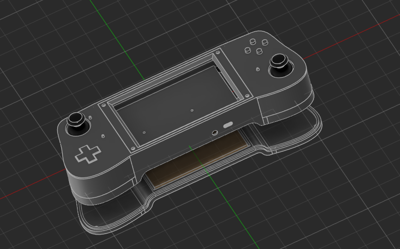
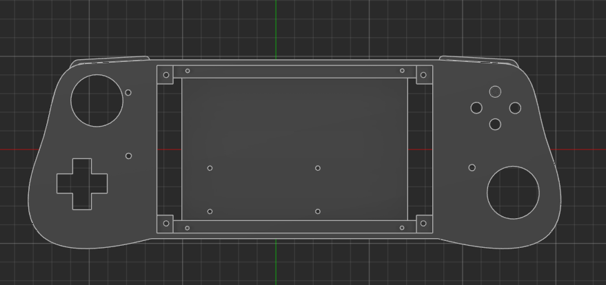
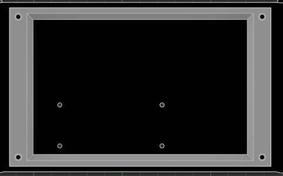

### streamie

---

a hackpad or a streaming device with a gamepad in which you can stream your games or play some retro games natively , hack it , add a keyboard and sky is your limit , it runs android !


---

## Cad 

this is the case i prepared 



## Flashing
for the Raxda please follow raxda offical guide , please flash it before assembly 
[Raxda Site](https://docs.radxa.com/en/cubie/a7z/other-system/android)

The controller runs on an RP2040-Zero and flashes by drag-and-drop. No programmer is needed.

### Option 1: flash a prebuilt file
1. Download `controller_xinput.uf2` from the Releases page.
2. Unplug the board from USB.
3. Hold the **BOOT** button and plug the board into your computer. Release BOOT once it's connected.
4. A drive named **RPI-RP2** appears. Drag `controller_xinput.uf2` onto it.
5. The drive disappears and the board restarts as a controller.

### Option 2: build it yourself
Requirements: [VS Code](https://code.visualstudio.com/) with the **Raspberry Pi Pico** extension. It installs the Pico SDK (2.x), compiler and CMake for you.

1. Clone this repo and open the `firmware/xinput` folder in VS Code (**File > Open Folder**). It must be the folder that directly contains `CMakeLists.txt`.
2. In the Pico extension, choose **Import Project** and select that folder.
3. Check that `CMakeLists.txt` has `set(PICO_BOARD waveshare_rp2040_zero)`. Use `pico` if you have a regular Raspberry Pi Pico.
4. Click **Compile Project**. The result is `build/controller_xinput.uf2`.
5. Flash it with the steps from Option 1.

If you use the command line instead, run:
```
mkdir build && cd build
cmake -DPICO_SDK_PATH=/path/to/pico-sdk ..
cmake --build .
```

### Verify it works
1. Keep the **sticks centered and the triggers released** when you plug it in, because they are calibrated at power-up.
2. On Windows, press **Win + R**, type `joy.cpl` and press Enter. The board should appear as **Xbox 360 Controller**.
3. Open **Properties** and check every button, both sticks and both triggers.
4. Pull each trigger fully once so it learns its travel.

### Settings in `main.c`
| Setting | What it does |
|---|---|
| `INVERT_LY`, `INVERT_RY` | Set to `true` if a stick's up and down are backwards |
| `STICK_DEADZONE` | Raise it if the sticks drift |
| `R3_PRESSED_BELOW` | Threshold for the right stick click, which is read through the MCP3008 (CH6) |

### Updating the firmware
Repeat the flashing steps. Always hold **BOOT** while plugging in, even if the board is already running this firmware.

### Troubleshooting
- **No RPI-RP2 drive:** try a different USB cable, because many cables carry power only. Make sure you hold BOOT *before* plugging in.
- **Not recognised as an Xbox controller:** check Device Manager for an unknown device, and try a different USB port.
- **Triggers read constant or backwards:** check the trigger pot wiring. The wiper (middle pad) must go to the MCP3008 channel.
- **Stick axes backwards:** flip `INVERT_LY` or `INVERT_RY` and re-flash.
- **No rumble:** it works only in games and testers that send XInput rumble. Check that the motor MOSFET gates are wired to GP26 and GP27.
- **Compile fails in VS Code:** make sure the open folder is the one containing `CMakeLists.txt`, then run **Clean CMake** and **Compile Project** again.

Compatibility: Windows and Linux. Consoles will not accept this controller.


---

## Assembly 

after printing the case add screen on in it 



then add the front latch to the screen and secure it with 4 M3 screws 


after that add all the buttons from the back 


then put the pcb on it 


and then rest of the parts and add aux post connected to the screen and add a A7z with stand off and wire everything 


connect the controller through usb cable after connecting both side with jst connector , then wire the tp4056 with buck convertor and make sure to set it at 5 v 

after that add the battery to the back and stick it to the back indent with m3 tape or doulbe side tape


after that then just wire it to the tp4056 
and the buckconvertor to the 5v n gnd of the Raxda A7z connect the display with hdmi and if u want touch a usb cable 

after all that 

just screw in the last 4 M3 screws 


and we are done ! 

---


# Bill of Materials (BOM)

| Sr. No. | Name | Link | Unit Price (USD) | Quantity | Total Price (USD) |
|---:|---|---|---:|---:|---:|
| 1 | JST male | [Product link](https://sharvielectronics.com/product/ph-14aw-14-pin-jst-right-angle-male-connector-2mm-pitch/) | 0.130 | 6 | 0.780 |
| 2 | JST female | [Product link](https://sharvielectronics.com/product/jst-ph-14-14-pin-single-side-female-to-free-end-connector-with-2mm-pitch-30cm-wire-length/) | 0.510 | 6 | 3.060 |
| 3 | 90-degree push button | [Product link](https://sharvielectronics.com/product/push-button-right-angle-tactile-switch-6x5mm-right-angle-tactile-switch-momentary-switch/) | 0.710 | 10 | 7.100 |
| 4 | Joystick | [Product link](https://sharvielectronics.com/product/thumb-joystick-switch-xy-dual-axis-4-way-direction/) | 0.660 | 4 | 2.640 |
| 5 | Screen | [Product link](https://makerbazar.in/products/waveshare-5-inch-capacitive-hdmi-lcd-display-h-800-480?variant=43342621311216) | 51.670 | 1 | 51.670 |
| 6 | Battery | [Product link](https://makerbazar.in/products/single-cell-3-7v-10000mah-lipo-battery?variant=48251044659440) | 4.120 | 1 | 4.120 |
| 7 | Buck converter (listed as XL6009) | [Product link](https://makerbazar.in/products/xl6009-dc-dc-adjustable-boost-buck-step-up-step-down-converter-module) | 0.670 | 1 | 0.670 |
| 8 | SMD push button | [Product link](https://makerbazar.in/products/5-2x5-2mm-smd-copper-push-button-tactile-switch?variant=48101517852912) | 0.200 | 2 | 0.400 |
| 9 | Vibration motor | [Product link](https://makerbazar.in/products/coin-type-micro-disc-vibration-motor?variant=48251066024176) | 0.200 | 4 | 0.800 |
| 10 | MCP3008 ADC | [Product link](https://sharvielectronics.com/product/mcp3008-i-p-8-channel-10-bit-adc-with-spi-interface-ic-dip-16-package/) | 3.530 | 1 | 3.530 |
| 11 | 1N4739A Zener diode (9.1 V) | [Product link](https://sharvielectronics.com/product/1n4739a-9-1v-1watt-zener-diode-%c2%b15-tolerance-do-41-package/) | 0.034 | 4 | 0.136 |
| 12 | Waveshare RP2040 Zero | [Product link](https://sharvielectronics.com/product/waveshare-rp2040-zero-without-header/) | 3.800 | 1 | 3.800 |
| 13 | AO3400 MOSFET | [Product link](https://sharvielectronics.com/product/ao3400-30v-5-8a-n-channel-mosfet-sot-23-package/) | 0.100 | 5 | 0.500 |
| 14 | RK09K1110A0J | [Product link](https://robu.in/product/1-month-warranty-1035/) | 0.580 | 2 | 1.160 |
| 15 | 10 kΩ resistor | [Product link](https://sharvielectronics.com/product/10k-ohm-1-watt-metal-film-resistor-1-tolerance/) | 0.920 | 10 | 9.200 |
| 16 | 100 Ω resistor | [Product link](https://sharvielectronics.com/product/100-ohm-1-2-watt-resistor-5-tolerance/) | 0.012 | 10 | 0.120 |
| 17 | 100 kΩ resistor | [Product link](https://sharvielectronics.com/product/100k-ohm-2-watt-metal-film-resistor-1-tolerance/) | 0.095 | 10 | 0.950 |
| 18 | Radxa Cubie A7Z | [Product link](https://evelta.com/cubie-a7z-tiny-size-mighty-ai-sbc-radxa/) | 62.120 | 1 | 62.120 |
| 19 | AUX port/cable | [Product link](https://sharvielectronics.com/product/3-5mm-aux-male-to-female-audio-extension-cable-1-meter/) | 1.020 | 1 | 1.020 |
| 20 | Micro-HDMI to HDMI cable/adapter | [Product link](https://sharvielectronics.com/product/micro-hdmi-male-to-hdmi-male-adapter/) | 1.540 | 1 | 1.540 |
| 21 | USB-C to USB-C cable | [Product link](https://www.amazon.in/Wayona-Powerbank-charging-compatible-Samsung/dp/B08WKJN4LF?source=ps-sl-shoppingads-lpcontext&smid=A2V43CXDBM3YTI&th=1) | 3.030 | 1 | 3.030 |
|  | **Grand Total** |  |  |  | **158.346** |

---

and we are done , ill update the github now when i make the project ~
